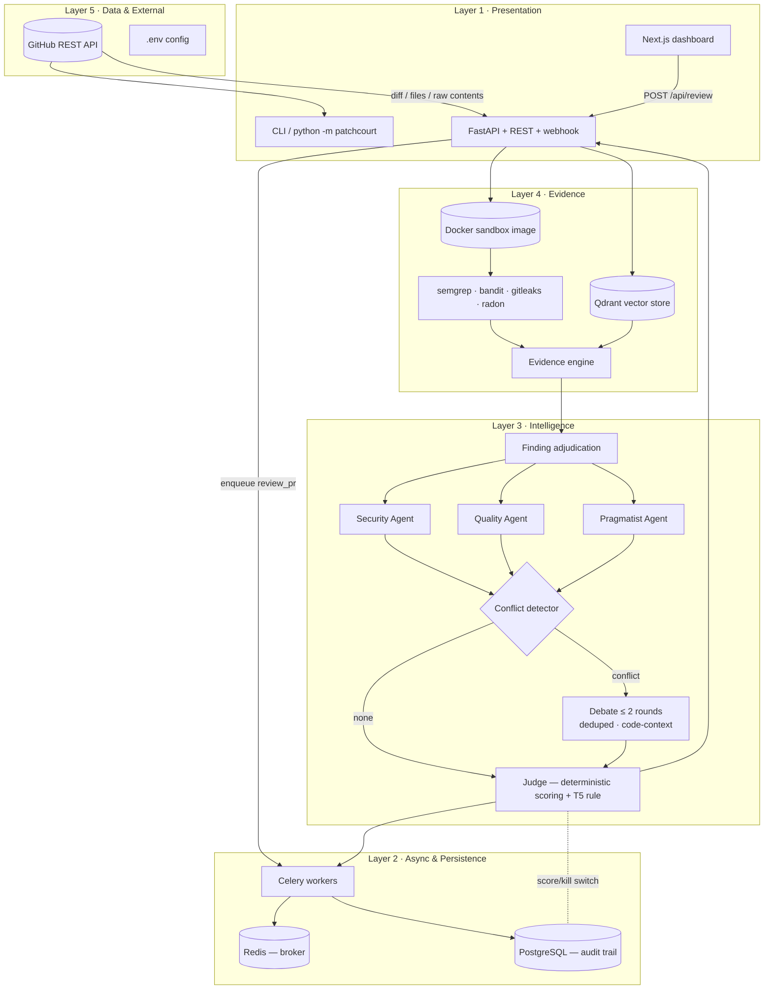

# PatchCourt

> Multi-agent, **evidence-tiered** AI code-review system for GitHub Pull Requests.


---

Three specialist LLM agents review a PR **in parallel**. Every claim is tied to a
static-analysis tool finding, repository policy, git precedent, or LLM reasoning —
each assigned a trust tier (T1–T5). Disagreements go through a **bounded,
code-context-aware, de-duplicated debate**, and a deterministic judge produces a
final score and verdict: `MERGE` | `NEEDS_REVIEW` | `BLOCK`.

> **BLOCK never rests on T5 alone.** A hard rule in the judge (enforced in code
> and unit-tested) downgrades verdicts that cross the block threshold only via
> LLM-only claims.

```
GitHub PR ──► ingest ──► RAG (Qdrant) ──► evidence engine ──► adjudication ──► parallel agents ──► conflict ─► (debate?) ──► judge ──► report
                     └──────────────────────── tools ─────────┘                                (sandboxed · code-context · deduped)
```

## Features

- **Evidence engine** — static-analysis adapters (semgrep · bandit · gitleaks · radon) produce
  T1–T2 findings; *corroboration* (two tools on the same line → T2 + `corroborated` flag) is first-class.
- **Finding adjudication** — every scanner finding is validated against the PR's changed
  lines, matched to repository policies, cross-tool correlated, and prioritised in context
  *before* it reaches an agent — the raw scanner count is never trusted as-is.
- **Docker sandbox** — untrusted PR code is materialized and scanned inside an isolated
  container (`--network none`, memory/pids limits): analysis cannot touch your host.
- **Tiered trust + hard BLOCK rule** — T5 (LLM) claims can never force a block on their own.
- **Code-context-aware debate** — disputes run a bounded, retrieval-gated debate (≤ 2 rounds).
  Both agents are primed with a line-window **code snippet** around the finding, and every turn
  is **de-duplicated** against prior turns (token-Jaccard), so the debate *converges* instead of
  restating itself.
- **Plain-English verdicts** — each dispute ends with a severity-tagged one-liner (what's wrong,
  why it matters, how to fix it), rendered as a banner above the transcript.
- **Dynamic comparison** — a SonarQube-shaped baseline is derived from the active review's own
  tool findings and reconciled finding-by-finding against PatchCourt's adjudication
  (supported / contradicted / out-of-scope / uncertain). Fully offline, no SonarQube needed.
- **Offline demo** — runs with zero credentials (`mock` LLM + synthetic scanner or sandbox).
- **Async pipeline** — GitHub webhook → Celery → Redis; full audit trail in PostgreSQL.
- **Next.js dashboard** — courtroom-themed, **state-synchronised** tabs: evidence docket, court
  debate transcript, SonarQube baseline, live SonarQube, dynamic comparison, history, settings.
- **Adjudication benchmark** — a labeled, offline harness scores finding-status accuracy,
  precision/recall/F1, and false-positive rate (`python -m patchcourt benchmark`).
- **LLM-agnostic** — mock / OpenAI / Claude / Gemini (free tier) / Ollama via `LLM_PROVIDER`,
  switchable at runtime from the dashboard Settings tab.

## Screenshots

| Overview (KPI, charts, verdict, evidence) | Evidence Docket (table, filters, expandable) |
|:---:|:---:|
|  |  |

| Courtroom Debate (verdict + code context) | Comparison (SonarQube vs PatchCourt) |
|:---:|:---:|
|  |  |

## Architecture — five layers



### Evidence tiers

| Tier | Weight | Meaning |
|------|--------|---------|
| T1   | 1.0    | Direct static-analysis tool flag with `file:line` |
| T2   | 0.8    | Two tools agree on the same line (corroborated) |
| T3   | 0.5    | Retrieved from repo policy / standards (RAG) |
| T4   | 0.4    | Git precedent — pattern from history / similar PRs |
| T5   | 0.1    | LLM reasoning only — *never blocks alone* |

**Hard constraint (enforced in `judge/scoring.py`, unit-tested):** if the score
crosses the block threshold only via T5-only claims, the verdict is downgraded to
`NEEDS_REVIEW`.

## Courtroom Debate

When the conflict detector finds two agents disagreeing about the same finding, the
dispute is escalated to a **bounded debate**. Each round gives a *prosecution* (the
claim's rationale) and a *defense* (the challenge) a turn to argue, with fresh RAG
evidence pulled in on rebuttal — capped at `debate_max_rounds` (default 2).

Two mechanisms keep the debate grounded and honest:

- **Code context.** Before a round, PatchCourt extracts a ±5-line **snippet** around the
  finding from the PR's own file contents and hands it — plus the identifiers it contains —
  to *both* agents. Rebuttals therefore cite the real surrounding code instead of guessing
  from the issue text. The snippet is returned as `code_snippet` on the transcript.
- **De-duplication & convergence.** Every turn is scored against *all* prior turns with
  token-Jaccard similarity (`_REDUNDANCY_THRESHOLD = 0.75`). A redundant turn is rejected
  and re-prompted with a "make a genuinely new argument" nudge; if an entire round repeats,
  the debate **converges early** and the last substantive turns are kept. Prior turns are
  never overwritten. Both system prompts carry an explicit no-repeat rule.

Each dispute also carries a **plain-English `verdict_summary`** — a severity-tagged line
(`⛔ Blocking`, `⚠️ Action Required`, `💡 Suggested`, …) describing the issue, its impact,
and a remediation hint. It is LLM-authored when a provider is configured and falls back to
a deterministic template offline, so it is always present.

The output is a `DebateTranscript` per dispute: `file`, `supporting`, `opposing`, `rounds`,
`code_snippet`, and `verdict_summary`. The dashboard's **Debate** tab renders the verdict
banner, the highlighted source snippet, and the (de-duplicated) argument turns.

## Comparison — SonarQube vs PatchCourt

The **Comparison** tab answers one question for the *active* PR: *of everything the scanner
reported, what did PatchCourt actually stand behind?*

The comparison is **derived from the review itself** — no separate scan, no external call.
`patchcourt/comparison.py` reshapes the review's tool-backed findings into a SonarQube-shaped
baseline (severity `BLOCKER…INFO`, type `VULNERABILITY / BUG / CODE_SMELL`), then reconciles
them against the review's `FindingAssessment` set using the shared baseline helpers:

- **Supported** — a scanner finding PatchCourt confirmed (corroborating tools highlighted).
- **Contradicted** — PatchCourt dismissed it as a false positive, with its rationale.
- **Out of scope / uncertain / unmatched** — for grouping the remainder.

Each row pairs the scanner finding (severity, rule, type, `file:line`, message) with
PatchCourt's contextual priority, action, rationale, and any matched repository policies,
plus a coverage metric (`adjudicated / total_in_pr`).

Because it rides on the shared review report (`ReviewReport.baseline_report`), the comparison
is **state-synchronised** with every other tab and **resets automatically** whenever a new
review runs — there is no stale workspace and no separate "refresh" call.

> The standalone **SonarQube Baseline** tab is a different, optional feature: it renders the
> newest *saved* SonarQube report (`GET /api/baseline/latest`) instantly — even when SonarQube
> is down — and can trigger a fresh live scan + reconciliation (`POST /api/baseline`) when a
> SonarQube server is running.

## Quick start (no keys, fully offline)

```bash
python3 -m venv .venv && source .venv/bin/activate
pip install -e ".[dev]"
python -m patchcourt review --demo
```

You'll get a `BLOCK` verdict driven by real evidence: shell-command injection,
SQL string concatenation, and a hardcoded secret flagged by static analysis, with
a mock-LLM dispute resolved through the debate stage. Everything — evidence
engine, tiers, corroboration, conflict detector, debate, judge — runs against a
deterministic stub.

```bash
# run the whole stack instead
docker compose build sandbox
docker compose up -d                                   # postgres + redis + qdrant + api
docker compose --profile worker --profile dashboard up # + celery worker + dashboard
curl -X POST localhost:8000/api/review/demo            # -> BLOCK
open http://localhost:3000                             # dashboard
```

## Usage

### CLI

```bash
python -m patchcourt review https://github.com/octocat/Hello-World/pull/1
python -m patchcourt review --demo                     # offline demo
python -m patchcourt review <pr_url> --quiet           # machine-readable
python -m patchcourt baseline <pr_url>                 # SonarQube-vs-PR report (writes reports/)
python -m patchcourt benchmark                         # offline adjudication benchmark
python -m patchcourt benchmark --quiet                 # summary only
```

### REST API

```bash
# offline demo
curl -X POST http://localhost:8000/api/review/demo

# review a real PR (response includes baseline_report — see Comparison)
curl -X POST http://localhost:8000/api/review \
  -H 'Content-Type: application/json' \
  -d '{"pr_url":"https://github.com/octocat/Hello-World/pull/1"}'

# newest saved SonarQube baseline (instant, offline-safe)
curl http://localhost:8000/api/baseline/latest

# fresh SonarQube scan + PatchCourt reconciliation — needs SonarQube running
curl -X POST http://localhost:8000/api/baseline \
  -H 'Content-Type: application/json' \
  -d '{"pr_url":"https://github.com/octocat/Hello-World/pull/1"}'
```

| Method & path | Purpose |
|---------------|---------|
| `POST /api/review` | Review a PR; response carries `baseline_report` (the derived comparison) |
| `POST /api/review/demo` | Offline demo review (synthetic scanner + mock LLM) |
| `GET /api/baseline/latest` | Newest *saved* SonarQube baseline (offline-safe) |
| `POST /api/baseline` | Fresh live scan + reconciliation (needs SonarQube) |
| `GET /api/comparison/demo` | Static hand-authored comparison workspace (legacy) |
| `GET /api/benchmark/latest` | Newest saved adjudication benchmark result |
| `POST /api/benchmark/run` | Run + save the offline adjudication benchmark |
| `GET /api/sonar/health` | Is SonarQube reachable? |
| `GET /api/sonar/quality-gate` | Quality-gate status (`?component=<key>`) |
| `GET /api/sonar/measures` | Component metrics (`?component=<key>`) |
| `GET /api/sonar/issues` | Paginated issue search (`?page=&severities=&types=&component=`) |
| `GET /api/settings/llm` | Current effective LLM settings (runtime overrides env) |
| `POST /api/settings/llm` | Update provider/model/key/base URL at runtime — no restart |
| `POST /api/settings/llm/test` | Test the current provider connection |
| `GET /health` | Liveness probe |

### GitHub webhook

```bash
curl -X POST http://localhost:8000/api/webhook/github \
  -H 'Content-Type: application/json' -H 'X-GitHub-Event: pull_request' \
  -d '{"action":"opened","pull_request":{"html_url":"https://github.com/octocat/Hello-World/pull/1"}}'
```

Returns `202` and hands the review to a Celery worker
(`patchcourt.worker.review_pr`). A `503` is returned when `REDIS_URL` is unset.
Every review is written to the PostgreSQL audit trail.
Repo webhook URL: `http://<host>:8000/api/webhook/github`.

### Dashboard (Next.js)

```bash
cd dashboard && npm install && npm run dev        # http://localhost:3000
npx shadcn@latest add button card badge tabs select input separator skeleton textarea label
```

Paste a PR URL (or hit **Offline Demo**). The review is held in a shared
`ReviewContext`, so **every tab renders from the same report** and a new run resets
them all at once — no stale views. The courtroom-themed sidebar has eight tabs:

| Tab | What it shows |
|-----|---------------|
| **Overview** | Verdict banner, KPIs, score breakdown, charts, T1–T5 legend |
| **Evidence** | Evidence docket — filter/sort by tier, severity, agent; corroborated pills; raw audit-payload toggle |
| **Debate** | Courtroom Debate transcript — **plain-English verdict banner** + highlighted **code snippet** per dispute |
| **SonarQube Baseline** | Newest *saved* SonarQube report (instant, works when Sonar is down); **Refresh baseline** runs a live `POST /api/baseline`; **Open SonarQube UI** → `http://localhost:9000` |
| **SonarQube Live** | Live quality gate, measures, and paginated issue search from a running SonarQube |
| **Comparison** | **Dynamic** SonarQube-vs-PatchCourt reconciliation for the active PR (derived from the review itself) |
| **History** | Past reviews from the PostgreSQL audit trail |
| **Settings** | Switch LLM provider/model/key at runtime and test the connection |

`NEXT_PUBLIC_API_BASE` defaults to `http://localhost:8000`.

## LLM providers

Set `LLM_PROVIDER` (default `mock`) in `.env`:

| Provider | `LLM_PROVIDER` | Needs | Default model |
|----------|----------------|-------|---------------|
| Mock (deterministic stub) | `mock` | nothing | — |
| OpenAI | `openai` | `LLM_API_KEY` | `gpt-4o` |
| Anthropic Claude | `claude` | `LLM_API_KEY` | `claude-3-5-sonnet-latest` |
| Google Gemini (free tier) | `gemini` | `LLM_API_KEY` (AI Studio) | `gemini-flash-latest` |
| Local Ollama | `ollama` | running Ollama server | `llama3.1` |

`LLM_BASE_URL` overrides the endpoint for `openai` (vLLM / LM Studio) and
`ollama` (defaults to `http://localhost:11434/v1`). Optional extras:
`pip install -e ".[llm]"` for Claude/Gemini, `pip install -e ".[rag]"` for
sentence-transformers embeddings (a deterministic hashing embedder is the
fallback).

## Docker Compose

| Service | Image | Role |
|---------|-------|------|
| `api`       | `patchcourt-api:latest`        | FastAPI: REST, webhook, dashboard backend, sandbox orchestration |
| `worker`    | `patchcourt-api:latest`        | Celery consumer of `review_pr` |
| `dashboard` | `patchcourt-dashboard:latest`  | Next.js courtroom UI (profile: `dashboard`) |
| `postgres`  | `postgres:16-alpine`           | Audit trail persistence |
| `redis`     | `redis:7-alpine`               | Celery broker |
| `qdrant`    | `qdrant/qdrant`                | Vector store for RAG grounding |
| `sandbox`   | `patchcourt-sandbox`           | Build-only tool image (profile: `tools`) |

The API/worker images ship the Docker CLI and mount the host socket, plus a
host-visible working directory (`SANDBOX_WORKDIR`) so per-run tool containers can
be launched against the same daemon — verified against Docker Desktop on macOS
and Linux daemons.

```bash
docker compose build sandbox          # build the tool image once
docker compose up -d                  # postgres, redis, qdrant, api
docker compose --profile worker up -d # optional: async webhook consumer
docker compose --profile dashboard up # optional: dashboard on :3000
```

## SonarQube baseline

Standalone SonarQube + a baseline comparison that maps *unresolved* SonarQube
issues onto the files a GitHub PR actually changes. Blocker/Critical findings
are mapped to **T1** tool-grade evidence, Major → T2, Minor → T3, Info → T4.

```bash
# one shot: boot SonarQube (embedded DB), create token, scan the repo, write report
bash scripts/run_sonar_demo.sh                       # optional PR_URL=...

# or manually, against an already-running SonarQube:
docker compose -f docker-compose.sonar.yml up -d
python -m patchcourt baseline https://github.com/octocat/Hello-World/pull/1
```

Output lands in `reports/baseline-<owner>-<repo>-<num>-<ts>.md` (+ `.json`):
total open issues, how many touch the PR, severity/type breakdown, and a
row-per-issue table with the suggested PatchCourt tier. Env:
`SONAR_URL`, `SONAR_TOKEN`, `SONAR_COMPONENT` (defaults in `.env.example`).

The same JSON is served by `GET /api/baseline/latest` (newest saved report,
no live SonarQube needed — the compose `api` mounts `./reports`). The
dashboard **SonarQube Baseline** tab reads it on load; **Refresh baseline**
calls `POST /api/baseline`, which fetches a fresh Sonar comparison, runs a
PatchCourt review of the PR, and reconciles the two into confirmed
(corroborated), down-tiered/unbacked, and Sonar-missed groups before saving a
new report.

## Configuration (`.env`)

Copy `.env.example` to `.env`. Everything is optional; the system runs offline
with no keys.

| Variable | Purpose | Default |
|----------|---------|---------|
| `GITHUB_TOKEN` | GitHub API token (rate limits, private repos) | *(anonymous)* |
| `LLM_PROVIDER` | `mock`\|`openai`\|`claude`\|`gemini`\|`ollama` | `mock` |
| `LLM_API_KEY` | Key for openai/claude/gemini | — |
| `LLM_BASE_URL` | OpenAI-compatible / Ollama base URL | `https://api.openai.com/v1` |
| `LLM_MODEL` | Model name | `gpt-4o` |
| `USE_MOCK_LLM` | Force deterministic mock | auto |
| `PATCHCOURT_TOOLS` | Commas-separated adapters | `semgrep,bandit,gitleaks,radon` |
| `USE_SYNTHETIC_TOOLS` | Add offline scanner | `false` |
| `PATCHCOURT_DEMO` | Force demo mode | `false` |
| `SANDBOX_ENABLED` | Run tools in Docker sandbox | `false` |
| `SANDBOX_IMAGE` / `SANDBOX_WORKSPACE` / `SANDBOX_WORKDIR` | Sandbox tuning | `patchcourt-sandbox:latest` / `/workspace` / `""` |
| `QDRANT_URL` / `QDRANT_COLLECTION` | Vector store | empty ⇒ in-memory |
| `REDIS_URL` | Celery broker | empty ⇒ no async |
| `DATABASE_URL` | SQLAlchemy audit DB | empty ⇒ no audit |
| `SONAR_URL` / `SONAR_TOKEN` / `SONAR_COMPONENT` | SonarQube baseline (saved reports) | `http://localhost:9000` / — / `patchcourt` |
| `SONAR_PROJECT_KEY` / `SONAR_HOST_URL` | SonarQube Live tab (health, gate, measures, issues) | `patchcourt` / `http://localhost:9000` |

> LLM provider, model, API key, and base URL can also be changed **at runtime** from
> the dashboard Settings tab (`/api/settings/llm`) without editing `.env` or restarting.

## Module layout

```
patchcourt/
├── agents/        # schemas, base agent, Security/Quality/Pragmatist specialists
├── ingest/        # GitHub REST ingestion (httpx) — diff, files, raw contents
├── rag/           # chunking + Qdrant store (real embeddings or deterministic hash)
├── evidence.py    # tier assignment + tool↔LLM corroboration (Evidence engine)
├── tools/         # adapter interface + semgrep/bandit/gitleaks/radon/synthetic
├── sandbox/       # containerized tool execution (docker CLI via socket)
├── adjudication/  # finding validation, policy rules, cross-tool correlation, context
├── debate/        # conflict detection + bounded, deduped, code-context debate
├── judge/         # deterministic scoring + verdict + BLOCK-never-on-T5 rule
├── baseline/      # SonarQube issue fetch + PR comparison + markdown/JSON report
├── comparison.py  # dynamic SonarQube-vs-PatchCourt comparison derived from a review
├── sonar_live.py  # live SonarQube health / quality gate / measures / issues
├── benchmark/     # labeled adjudication dataset + metrics + saved results
├── db/            # SQLAlchemy models + audit persistence (PostgreSQL)
├── worker/        # Celery app + review_pr task
├── api/           # FastAPI app + webhook router (see REST API table)
├── graph.py       # LangGraph pipeline wiring
├── demo.py        # bundled insecure demo PR
├── demo_comparison.py  # static hand-authored comparison workspace (legacy)
├── runtime_llm_config.py  # runtime LLM overrides (Settings tab)
├── cli.py         # `python -m patchcourt review|baseline|benchmark`
├── llm.py         # provider dispatch (mock/openai/claude/gemini/ollama)
└── config.py      # .env settings + tier weights
```

## Tests

```bash
pytest -q     # 132 tests
```

Covered: tier weights, judge scoring math, the **BLOCK-on-T5-alone** rule, conflict
gating, PR URL parsing, evidence-engine corroboration, **debate de-duplication &
convergence**, **code-snippet extraction + plain-English verdict summaries**,
finding validation / policy rules / correlation / contextual prioritisation
(adjudication), the **adjudication benchmark** metrics, **dynamic SonarQube-vs-PatchCourt
comparison**, Qdrant store, sandbox graceful-skip behavior, webhook routing, Celery
task registration, LLM provider dispatch + runtime settings, SonarQube baseline
comparison, and an offline end-to-end pipeline through the real LangGraph + RAG + judge
stack with a fake LLM.

## Field demo runbook

The full ordered path, from a clean clone to a live container sandbox review:

1. **Bootstrap**
   ```bash
   python3 -m venv .venv && source .venv/bin/activate
   pip install -e ".[dev]"
   cp .env.example .env        # optional; everything defaults to mock/offline
   ```

2. **Unit/offline checks**
   ```bash
   pytest -q                                    # 132 tests
   python -m patchcourt review --demo           # BLOCK 15.8, 1 debate (no keys)
   ```

3. **Sandbox tool image** (isolated analysis runtime)
   ```bash
   docker compose build sandbox
   ```

4. **Full stack** — Postgres + Redis + Qdrant + API (dashboard + worker opt-in)
   ```bash
   docker compose up -d
   docker compose --profile worker --profile dashboard up -d
   curl -X POST localhost:8000/api/review/demo   # BLOCK via real sandbox tools
   docker compose exec -T postgres psql -U patchcourt -d patchcourt \
     -c "SELECT pr_url, verdict, overall_score FROM pr_reviews ORDER BY id DESC LIMIT 3;"
   ```

5. **Async webhook → Celery** (writes a public PR through the queue)
   ```bash
   curl -X POST localhost:8000/api/webhook/github \
     -H 'Content-Type: application/json' -H 'X-GitHub-Event: pull_request' \
     -d '{"action":"opened","pull_request":{"html_url":"https://github.com/octocat/Hello-World/pull/1"}}'
   docker compose logs worker --tail=20        # watch ingest → qdrant → sandbox → audit
   ```

6. **Dashboard**
   ```bash
   # open http://localhost:3000 — click "Offline Demo", or paste a PR URL.
   cd dashboard && npm install && npm run dev  # alternate local run
   ```

7. **SonarQube baseline**
   ```bash
   bash scripts/run_sonar_demo.sh              # boots SonarQube, scans repo, writes reports/
   ```

8. (Optional) **Real LLM grounding**
   ```bash
   # .env
   LLM_PROVIDER=gemini   # or claude / openai / ollama
   LLM_API_KEY=...
   python -m patchcourt review https://github.com/<owner>/<repo>/pull/<n>
   ```
